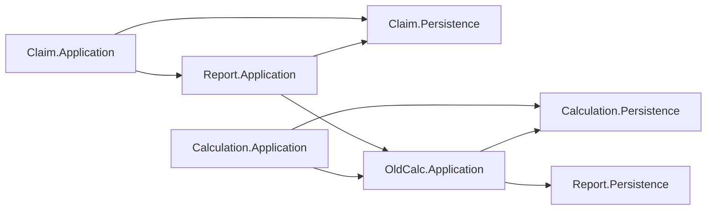

# بررسی معماری و هزینهٔ نگهداری Aban360

تاریخ: ۲۰۲۶/۱۱/۰۵  
مبنای بررسی: `811ce2952` و وضعیت فعلی فایل‌های محلی  
وضعیت: گزارش و پیشنهاد؛ هیچ بازآرایی معماری در این نوبت اجرا نشده است.

## نتیجهٔ اصلی

پروژه از نظر فیزیکی به Poolها و لایه‌های متعدد تقسیم شده، اما مرز تغییر قابلیت‌ها با این تقسیم‌بندی منطبق نیست. یک تغییر در مفهوم «مشترک»، «محاسبهٔ قبض» یا «گزارش» می‌تواند هم‌زمان قراردادهای چند Pool، شکل دادهٔ قدیمی، هماهنگی تراکنش و خروجی نمایشی را درگیر کند. در مسیرهای بررسی‌شده، **محل استقرار کد بیش از آنکه مالک قابلیت را مشخص کند، نوع فنی فایل را مشخص می‌کند**.

بنابراین مسئلهٔ اصلی، کمبود لایه یا interface نیست. مسئله این است که مالک بعضی تصمیم‌ها و مدل‌ها روشن نیست و مرزهای موجود، انتشار تغییر را محدود نمی‌کنند. حتی با فرض درست‌بودن خروجی تمام عملیات، این وضعیت هزینهٔ فهم و تغییر را بالا می‌برد.

این نتیجه به معنی نیاز به تبدیل سامانه به microservice یا تعویض ORM نیست. اصلاح پیشنهادی در همان برنامهٔ یکپارچه، به‌صورت قابلیت‌به‌قابلیت و با حفظ رفتار فعلی انجام می‌شود.

## دامنه و اعتبار شواهد

بررسی شامل این کارها بود:

1. استخراج تمام `ProjectReference`های ۸۷ پروژه و تفکیک پروژه‌های تست، میزبان و کتابخانه؛ بررسی جهت وابستگی در سطح پروژه و Pool.
2. دنبال‌کردن مصرف واقعی در مسیرهای تغییر مشترک، تأیید درخواست انشعاب، محاسبه/تأیید قرائت، گزارش «بدون قبض»، فهرست روش پرداخت و درخواست مشترک با OTP.
3. خواندن نمونه‌های قراردادهای Gateway، DTOهای مشترک، سیاست‌های خانوار، نوشتن دادهٔ اصلی/تاریخچه/warehouse و هماهنگی فایل، HTTP و job.
4. بررسی ۱۵۰ commit غیرادغامی اخیر که فایل C# یا پروژه را تغییر داده‌اند، برای مشاهدهٔ تغییر هم‌زمان Poolها؛ نه برای قضاوت دربارهٔ عملکرد افراد.
5. مقایسه با بخش‌های دارای جداسازی بهتر در خود مخزن، به‌ویژه SubscriberRequests و بخشی از BankReceipt.

تمام فایل‌ها خط‌به‌خط خوانده نشده‌اند. جست‌وجو و استخراج گراف سراسری بوده و خواندن عمیق روی مسیرهای نام‌برده انجام شده است. شمارش‌های متنی، تحلیل معنایی کامل C# یا اندازه‌گیری زمان نگهداری نیستند. تعداد using یا ارجاع پروژه به‌تنهایی اثبات مصرف نیست؛ در یافته‌ها نمونهٔ فراخوانی و عبور داده هم آمده است.

این نوبت بررسی ایستا بود؛ برای تهیهٔ گزارش، Build، تست اجرایی، migration یا عملیات پایگاه داده اجرا نشد. نتایج اجرای تست در پیگیری قبلی M04، شواهد پوشش کامل معماری محسوب نشده‌اند. استنباط‌های معماری از واقعیت مشاهده‌شدهٔ کد جدا شده‌اند؛ صحت قواعد تعرفه و مالکیت سازمانی داده نیازمند تأیید صاحبان دامنه است.

تغییرات محلی موجود حفظ شدند. M03، طبق تصمیم قبلی کاربر، باز می‌ماند و فعلاً تغییر نمی‌کند؛ هیچ پیشنهاد این گزارش مجوز ضمنی تغییر آن مسیر نیست.

## نقشهٔ فعلی و نشانه‌های انتشار تغییر

| مشاهده | مقدار/نمونه | معنای قابل استناد | چیزی که از آن نتیجه نمی‌گیریم |
|---|---|---|---|
| پروژه‌های قابل بررسی | ۸۷ پروژه؛ ۷۴ غیرتستی | تفکیک فیزیکی قابل توجه است | زیادبودن پروژه به‌خودی‌خود بد نیست |
| ارجاع بین Poolها | ۸۰ ارجاع پروژه در ۴۵ رابطهٔ متمایز، پس از کنارگذاشتن ارجاعات خروجی ۵ میزبان و با احتساب Common | اتصال ماژول‌ها فقط از میزبان مرکزی عبور نمی‌کند | همهٔ این ارجاعات ناموجه یا بلااستفاده نیستند |
| Application به Persistence همان Pool | ۱۴ مورد از ۱۵ پروژهٔ Application | قراردادهای بسیاری همراه پیاده‌سازی ذخیره‌سازی مصرف می‌شوند | صرف این جهت وابستگی، اثبات خطای طراحی نیست؛ مصرف جزئیات فنی در ادامه ملاک است |
| هماهنگی SQL در Application | جست‌وجوی متنی در ۱۴۳ فایل، `BeginTransaction` پیدا کرد؛ در ۱۴۱ فایل ساخت مستقیم CommandService دیده شد | الگوی اختلاط گردش کار و ذخیره‌سازی محدود به یک کلاس نیست | این اعداد معادل تعداد تراکنش اجراشده یا شمارش دقیق AST نیستند |
| وابستگی به زمینهٔ HTTP در Application | عبارت `IHttpContextAccessor` در ۹۱ فایل | اجرای منطق کاربردی غالباً به زمینهٔ میزبان گره خورده است | تک‌تک این مصرف‌ها بررسی معنایی نشده‌اند |
| تغییر هم‌زمان در تاریخچه | ۶۷ مورد از ۱۵۰ commit نمونه، بیش از یک Pool کسب‌وکاری را تغییر داده‌اند | تغییرهای چندماژولی در مخزن رایج‌اند | commit مشترک به‌تنهایی رابطهٔ علّی یا معماری بد را ثابت نمی‌کند |
| زوج‌های پرتکرار تغییر هم‌زمان | Claim/Report: ۲۳؛ Calculation/Claim: ۲۱؛ Calculation/Report: ۲۱ | با مسیرهای واقعی بررسی‌شده هم‌راستاست | زمان یا هزینهٔ واقعی هر تغییر اندازه‌گیری نشده است |

در استخراج نام‌ها، `Aban260.BlobPool.Infrastructure` در خانوادهٔ BlobPool قرار گرفت و Common و Common.Db برای نقشهٔ Pool در یک گروه جمع شدند. پنج پروژهٔ وب کنارگذاشته‌شده از شمارش ارجاعات خروجی عبارت‌اند از Api، BrdigeApi، FuckApi، HealthApi و Sms؛ نام‌گذاری فعلی حفظ شده است. پروژه‌های NotificationPool بدون پسوند لایه و s.y در snapshot حاضر ارجاع پروژه‌ای ندارند و در این عدد اثری ندارند.

**در گراف پروژه‌ها چرخهٔ مستقیم پیدا نشد.** اما وقتی لایه‌ها را در Pool خود جمع کنیم، رفت‌وبرگشت وابستگی دیده می‌شود. مثال‌های زیر ارجاع واقعی پروژه‌اند؛ چرخهٔ کامپایل نشان نمی‌دهند:

برای مثال، Claim از Report.Application استفاده می‌کند، درحالی‌که Report.Application به Claim.Persistence دسترسی دارد. این اتصال می‌تواند کاملاً قابل build باشد، ولی مالک قرارداد بین این دو قابلیت را مبهم می‌کند.

## تغییرهای نمونه: هزینه کجا پخش می‌شود؟

این جدول مسیرهایی را که خوانده شدند به تغییرهای قابل تصور وصل می‌کند. تغییرهای زیر اجرا نشده‌اند و تعداد فایل موردنیاز برای هر تغییر به جزئیات درخواست وابسته است.

| تغییر قابل تصور | مسیرهای درگیر فعلی | علت انتشار تغییر | مرز مطلوب |
|---|---|---|---|
| تغییر روش نگهداری تاریخچهٔ اطلاعات مشترک | CustomerUpdateHandler، RequestCofirmeHandler، ArchMem/Members/ClientsCommandService | چند گردش کار، توالی نوشتن اصلی، تاریخچه و مدل خواندنی را می‌شناسند | عملیات مالک اطلاعات مشترک، با همان تضمین تراکنشی فعلی |
| تغییر سیاست محاسبهٔ واحد خانوار | ConsumptionCalculator، GenerateBillHandler، FreeGenerateBillHandler، MeterReadingDetailUpdateHandler و CustomerInfoOutputDto | سیاست در چند مسیر و چند شکل داده بازنمایی شده است | سیاست نام‌دار با تاریخ و زمینهٔ صریح و حالت‌های مصوب |
| اضافه‌کردن بعد گروه‌بندی به گزارش بدون قبض | queryهای پایه/خلاصه، handler/interfaceها، DTOهای خروجی، controller و مسیرهای Excel/STI | تعریف داده، تجمیع و نحوهٔ تحویل خروجی با هم گسترش می‌یابند | تعریف مستقل خانوادهٔ گزارش و نمایش‌های مشخص آن |
| اجرای تأیید درخواست از کار پس‌زمینه | RequestCofirmeHandler، زمینهٔ کاربر/HTTP، ثبت OpLog و هماهنگی SQL | اطلاعات اجرا و زیرساخت به مسیر کسب‌وکار متصل‌اند | فرمان کاربردی با زمینهٔ اجرای صریح و adapterهای میزبان |
| اضافه‌کردن یک فیلد به فهرست سادهٔ روش پرداخت | entity، DTO، mapper، query و handler و قراردادهای مربوط | لایه‌های عبوری متعدد و سازمان‌دهی براساس نوع فایل | تغییر محلی در قابلیت خواندنی، با قرارداد عمومی ثابت |

## اولویت‌بندی

اولویت بر اساس **گسترهٔ انتشار تغییر، نقش در قابلیت‌های پرتکرار، بار فهم و تعداد تصمیم‌های مستقلِ درهم‌تنیده** تعیین شده است. ریسک اجرای بازآرایی جدا از اهمیت مسئله آمده؛ اولویت بالا به معنی توصیهٔ تغییر بزرگ و فوری نیست.

| رتبه/شناسه | مسئلهٔ معماری | اولویت | ریسک اصلاح گسترده | نخستین گام محدود | وضعیت |
|---|---|---|---|---|---|
| ۱ / A01 | مرز Poolها با قرارداد مصرف قابلیت محافظت نمی‌شود | بالا | بالا | یک رابطهٔ خواندنی بین دو Pool را از پیاده‌سازی جدا کنیم | بررسی‌شده؛ اجرا تأیید نشده |
| ۲ / A02 | مالک هماهنگی دادهٔ اصلی، تاریخچه و مدل خواندنی روشن نیست | بالا | بالا | ثبت نقشهٔ مالکیت و پوشاندن یک عملیات تغییر مشترک پشت مرز مشخص | بررسی‌شده؛ اجرا تأیید نشده |
| ۳ / A03 | قواعد و مدل محاسبه بین مسیرها و مدل‌های قدیمی پخش شده‌اند | بالا | بالا | یک سیاست مثل واحد خانوار را با حفظ تفاوت‌های فعلی مستند و محصور کنیم | بررسی‌شده؛ اجرا تأیید نشده |
| ۴ / A04 | گردش کار کاربردی با SQL و زمینهٔ اجرا درهم‌تنیده است | بالا | بالا | جداسازی تصمیم و ثبت در یک use case محدود، بدون تغییر تراکنش | بررسی‌شده؛ اجرا تأیید نشده |
| ۵ / A05 | Common هم هستهٔ مشترک است، هم مالک چند قابلیت و زیرساخت | متوسط رو به بالا | متوسط تا بالا | طبقه‌بندی قراردادهای مشترک و جلوگیری از افزودن وابستگی دامنه‌ای تازه | بررسی‌شده؛ اجرا تأیید نشده |
| ۶ / A06 | گزارش‌گیری، قرارداد دادهٔ عملیاتی و قالب ارائه را هم‌زمان حمل می‌کند | متوسط رو به بالا | متوسط تا بالا | یک خانوادهٔ گزارش را از قالب تحویل و دادهٔ عملیاتی جدا کنیم | بررسی‌شده؛ اجرا تأیید نشده |
| ۷ / A07 | ساختار فایل‌ها حول عملیات فنی، هزینهٔ پیمایش و گسترش قابلیت را بالا می‌برد | متوسط | متوسط؛ در تغییر انبوه بالا | آزمایش ساختار مبتنی بر قابلیت روی یک تغییر کوچک | بررسی‌شده؛ اجرا تأیید نشده |
| ۸ / A08 | مرزهای معماری و مسیرهای مهاجرت، قرارداد قابل بررسی ندارند | متوسط؛ اقدام آغازین کم‌ریسک | پایین برای مستندسازی و کنترل رشد | ثبت وضعیت فعلی و کنترل فقط وابستگی‌های تازه | بررسی‌شده؛ اجرا تأیید نشده |

این‌ها هشت مسئلهٔ معماری‌اند، نه هشت مورد افزوده بر بیست کار قبلی. یافته‌های M قبلی سابقهٔ جداگانهٔ جزئیات و اصلاحات اجراشده‌اند؛ بعضی فقط نمونهٔ یک مسئلهٔ A هستند. برای ادامه می‌توان A01 تا A05 را در بستهٔ اول و A06 تا A08 را در بستهٔ دوم بررسی کرد. هیچ‌یک با مجوز قبلی M04 خودکار تأیید نشده‌اند.

## A01 — مرز Poolها با قرارداد مصرف قابلیت محافظت نمی‌شود

**مشاهده:** مسیر فراخوانی بین ماژول‌ها یک قاعدهٔ یکنواخت ندارد: گاهی Gateway، گاهی Application ماژول دیگر، گاهی Persistence آن مصرف می‌شود. قراردادهای عمومی نیز غالباً DTOهای Domain همان ماژول را عبور می‌دهند. وجود Gateway در بعضی روابط، بقیهٔ دسترسی‌ها را محدود نمی‌کند.

**شواهد مشخص:**

- `Aban360.ClaimPool.Application/Aban360.ClaimPool.Application.csproj:24` و خط ۲۷، ارجاع به Report.Application و User.Persistence دارند؛ `Aban360.ReportPool.Application/Aban360.ReportPool.Application.csproj:18` به Claim.Persistence برمی‌گردد.
- `Aban360.CalculationPool.Application/Aban360.CalculationPool.Application.csproj:31` به OldCalc.Application وابسته است و `Aban360.OldCalcPool.Application/Aban360.OldCalcPool.Application.csproj:20` از Calculation.Persistence استفاده می‌کند.
- مصرف واقعی قرارداد ذخیره‌سازی Report در موتور محاسبه: `Aban360.OldCalcPool.Application/Features/Processing/Handlers/Commands/Implementations/OldTariffEngine.cs:30`، وابستگی `IBillIdTagQueryService`.
- `Aban360.ReportPool.GatewayAdhoc/Features/ConsumersInfo/Contracts/IIntervalBillPrerequisiteInfoAddHoc.cs:7` نوع `IntervalBillSubscriptionInfo` از Report.Domain را به مصرف‌کنندهٔ محاسبه می‌دهد؛ Gateway فعلی adapter اجرایی هم دارد و پروژه‌اش به Report.Application وابسته است.

**چرا نگهداری گران می‌شود؟** مصرف‌کننده به‌جای بیان «برای محاسبه به چه اطلاعاتی نیاز دارم»، با قرارداد داخلی عرضه‌کننده هماهنگ می‌شود. تغییر query یا DTO داخلی می‌تواند به تغییر چند Pool تبدیل شود. جهت تصمیم‌گیری هم روشن نیست: آیا Rule در Report تعریف می‌شود، در Claim، یا در محاسبات؟

**نمونهٔ تغییر:** اگر ساختار tagهای مؤثر بر تعرفه تغییر کند، موتور محاسبه اکنون قرارداد query ذخیره‌سازی Report را می‌شناسد. یک قرارداد کوچکِ «ویژگی‌های مؤثر بر محاسبه» می‌تواند این تغییر را به adapter عرضه‌کننده محدود کند.

**اصلاح تدریجی:** برای یک رابطهٔ خواندنی، مالک و مصرف‌کنندهٔ قابلیت را مشخص کنیم؛ یک قرارداد کوچک متناسب با نیاز مصرف‌کننده تعریف و آن را با پیاده‌سازی فعلی تغذیه کنیم. ابتدا فراخوانندهٔ جدید از این مرز عبور کند؛ حذف ارجاع پروژه فقط وقتی انجام شود که مصرف‌های قبلی واقعاً تمام شده‌اند. برای هر Pool یک پروژهٔ جدید اجباری نیست؛ محل قرارداد باید با امکان اعمال مرز و هزینهٔ ساخت متناسب باشد.

**معیار موفقیت:** تغییر جزئیات query عرضه‌کننده، امضای مصرف‌کننده را تغییر ندهد؛ مصرف‌کنندهٔ منتقل‌شده به قرارداد Persistence ماژول دیگر نیاز نداشته باشد؛ وابستگی تازهٔ مستقیم بدون دلیل ثبت‌شده اضافه نشود. حفظ API عمومی و رفتار فعلی جزو معیار است.

## A02 — هماهنگی دادهٔ اصلی، تاریخچه و مدل خواندنی، مالک عملیاتی مشخصی ندارد

**مشاهده:** در تغییر مشترک و تأیید درخواست، خود handler توالی به‌روزرسانی دادهٔ عملیاتی، نگهداری تاریخچه و بازسازی Clients در CustomerWarehouse را مدیریت می‌کند. در تأیید قبض نیز هماهنگی چند نمایش از قبض و بدهی داخل گردش کار قرار دارد. بنابراین مدل خواندنی صرفاً مصرف‌کنندهٔ رویداد یا خروجی مالک داده نیست؛ روش به‌روزرسانی آن بخشی از دانش چند use case است.

**شواهد مشخص:**

- `Aban360.ClaimPool.Application/Features/Land/Handlers/Commands/Update/Implementations/CustomerUpdateHandler.cs:241`، توالی ArchMem، Members و Clients را در کنار log اجرا می‌کند؛ بازسازی Clients در خط ۲۶۲ است.
- `Aban360.ClaimPool.Application/Features/Request/Handler/Commands/Create/Implementations/RequestCofirmeHandler.cs:100` همین خانوادهٔ نوشتن را در مسیر تأیید درخواست می‌شناسد؛ خط ۱۳۳ مدل خواندنی را بازسازی می‌کند.
- `Aban360.ClaimPool.Persistence/Features/Land/Commands/Implementations/ClientsCommandService.cs:25` و خط ۴۵ نشان می‌دهد ساخت Clients به شناسه و ساختار ArchMem وابسته است.
- `Aban360.CalculationPool.Application/Features/MeterReading/Handlers/Commands/Creata/Implementations/CalculationConfirmationHandler.cs:239` هماهنگی BedBes، KasrHa، Bills، Members، Contor و WaterDebt را حمل می‌کند؛ `Aban360.OldCalcPool.Persistence/Features/Processing/Commands/Implementations/BillCommandService.cs:297` مدل Bills در CustomerWarehouse را می‌سازد.

**چرا نگهداری گران می‌شود؟** برای اضافه‌کردن یک نمایش داده یا تغییر روش تاریخچه، نگهدارنده باید همهٔ گردش‌های نویسنده را پیدا کند و توالی هماهنگی آن‌ها را حفظ کند. مرز Pool یا نام کلاس به‌تنهایی نمی‌گوید چه کسی تضمین می‌کند دادهٔ اصلی و نمایش‌های آن با هم سازگار بمانند.

**محدودیت نتیجه:** از این شواهد، ناسازگاری فعلی داده یا لزوم جداسازی پایگاه داده نتیجه نمی‌شود. نوشتن هم‌زمان در warehouse ممکن است تصمیم ضروری سامانهٔ قدیمی باشد. مالکیت پیشنهادی «مشترک» و «قبض» باید با دامنه و دسترسی سامانه‌های بیرونی تطبیق داده شود؛ trigger، job و نویسنده‌های بیرون مخزن بررسی نشده‌اند.

**اصلاح تدریجی:** نقشهٔ منبع اصلی، تاریخچه و نمایش‌های خواندنیِ هر مفهوم ثبت شود؛ سپس یک عملیات مثل تغییر موبایل پشت قرارداد مالک مشترک قرار گیرد و همان توالی SQL و همان تراکنش فعلی را اجرا کند. handler نباید بداند چه زمانی Clients از ArchMem ساخته می‌شود. ثبت غیرهم‌زمان projection یا event bus تنها در صورت نیاز و پذیرش تغییر تضمین سازگاری مطرح شود؛ پیش‌فرض این پیشنهاد حفظ ثبت هم‌زمان است.

**معیار موفقیت:** تغییر روش همگام‌سازی Clients فقط در مرز مالک آن انجام شود؛ دو مسیر تغییر مشترک از عملیات مصوب یکسان استفاده کنند؛ تضمین فعلی اتمیک‌بودن حفظ شود. مالکیت دادهٔ یکسان به معنی یک کلاس عمومی برای همهٔ جدول‌ها نیست.

## A03 — قواعد محاسبه و زبان مدل قدیمی، به مرزهای مشخص محدود نشده‌اند

**مشاهده:** «واحد مؤثر خانوار»، شکل اطلاعات مشتری، خواندن دادهٔ پیش‌نیاز و نگاشت نتیجه به مدل ذخیره، در چند مسیر محاسبه حضور دارند. هم موتور قدیمی و هم مسیر محاسبهٔ بازه‌ای وجود دارند، ولی قرارداد واحدی در شواهد خوانده‌شده دیده نشد که روشن کند هرکدام کدام سناریوها را مالک‌اند. نام Old به معنی متروک‌بودن نیست؛ مسیرهای جاری از آن استفاده می‌کنند.

**شواهد مشخص:**

- سیاست واحد خانوار در `Aban360.OldCalcPool.Application/Features/Processing/Helpers/ConsumptionCalculator.cs:132`، `Aban360.OldCalcPool.Application/Features/Processing/Handlers/Commands/Implementations/GenerateBillHandler.cs:232` و `Aban360.CalculationPool.Application/Features/MeterReading/Handlers/Commands/Update/Implementations/MeterReadingDetailUpdateHandler.cs:582` بازنمایی شده است؛ FreeGenerateBillHandler هم مسیر مشابه دارد.
- `Aban360.OldCalcPool.Domain/Features/Processing/Dto/Queries/Output/CustomerInfoOutputDto.cs:32` در property و از خط ۷۶ در constructor، قواعد خانوار و تاریخ را نیز اعمال می‌کند؛ یعنی این DTO فقط حامل داده نیست.
- `Aban360.OldCalcPool.Application/Features/Processing/Handlers/Commands/Implementations/OldTariffEngine.cs:117` آماده‌سازی داده و محاسبه را ترکیب می‌کند؛ `Aban360.CalculationPool.Application/Features/Base/BaseIntervalTariffEngine.cs:15` مسیر و مدل پیش‌نیاز دیگری دارد.
- زبان مدل قدیمی تا Application رسیده: `Aban360.CalculationPool.Application/Features/MeterReading/Handlers/Commands/Creata/Implementations/CalculationConfirmationHandler.cs:359` نتیجه را به BedBes نگاشت می‌کند؛ `Aban360.ClaimPool.Application/Features/Request/Handler/Commands/Create/Implementations/MoshtrakService.cs:29` انتخاب خدمات را به `s0/s1/...` تبدیل می‌کند.

**چرا نگهداری گران می‌شود؟** برای تغییر یک سیاست باید هم سناریوهای مختلف و هم نام‌های فنی دادهٔ قدیمی را فهمید. قواعدی که در DTO یا آماده‌سازی داده اجرا می‌شوند ممکن است از دید خوانندهٔ calculator پنهان بمانند. تغییر یک شکل ذخیره‌سازی نیز به منطق کاربردی راه پیدا می‌کند.

**نکتهٔ دامنه:** نسخه‌های دیده‌شده کاملاً هم‌معنا نیستند: بعضی از تاریخ قرائت و بعضی از زمان جاری استفاده می‌کنند؛ رفتار باغ/اقامتگاه هم در نمونه‌ها تفاوت دارد. این گزارش هیچ‌کدام را غلط اعلام نمی‌کند و ادغام کورکورانهٔ آن‌ها پیشنهاد نمی‌شود.

**اصلاح تدریجی:** ابتدا ماتریس «سناریوی محاسبه × موتور × تاریخ مؤثر × سیاست خانوار» ثبت شود. برای یک سیاست، ورودی و زمینهٔ تصمیم صریح و نتایج فعلی هر سناریو تثبیت شوند؛ تفاوت عمدی با نام جدا حفظ شود. محاسبه از بارگذاری داده و نگاشت BedBes/KasrHa جدا گردد. نام‌ها و کدهای legacy در adapter باقی بمانند؛ دو موتور فقط پس از اثبات هم‌معنایی قابل ادغام‌اند.

**معیار موفقیت:** تغییر یک سیاست مشخص در یک مالک نام‌دار انجام شود و فهرست سناریوهای متأثر معلوم باشد؛ تغییر ستون قدیمی نیازمند دست‌کاری محاسبهٔ خالص نباشد؛ نتیجهٔ سناریوهای فعلی حفظ شود. ساخت «DTO عظیم مشترک برای همهٔ محاسبات» هدف این اصلاح نیست.

## A04 — گردش کار کاربردی، تصمیم کسب‌وکار و شیوهٔ اجرای فنی را با هم حمل می‌کند

**مشاهده:** در handlerهای مهم، انتخاب و اعتبارسنجی عملیات کنار ساخت سرویس SQL، انتخاب سطح تراکنش، برداشت اطلاعات HTTP، ثبت audit و گاهی هماهنگی job و فایل قرار دارد. مشکل صرفاً طول کلاس نیست؛ این اجزا به دلایل مستقل تغییر می‌کنند.

**شواهد مشخص:**

- `Aban360.ClaimPool.Application/Features/Request/Handler/Commands/Create/Implementations/RequestCofirmeHandler.cs:26` از پایهٔ اتصال ارث می‌برد؛ متد خط ۱۰۰ خودش سرویس‌های ذخیره‌سازی را می‌سازد و تراکنش را مدیریت می‌کند.
- `Aban360.CalculationPool.Application/Features/MeterReading/Handlers/Commands/Creata/Implementations/CalculationConfirmationHandler.cs:239` هم داده‌های ثبت نهایی و هم جزئیات هماهنگی SQL را دریافت می‌کند.
- `Aban360.Common.Db/Services/OpLogService.cs:40` برای ثبت audit به Request و Connection زمینهٔ HTTP رجوع می‌کند؛ استفاده از همان گردش کار از job، زمینهٔ اجرایی متفاوتی می‌خواهد.
- `Aban360.CalculationPool.Application/Features/Base/CollectBillsDetailJobService.cs:30` هم از اتصال SQL ارث می‌برد و هم Hangfire، فایل و سرویس بیرونی را هماهنگ می‌کند.
- مرز ورودی نیز در نمونه‌ای به میزبان وابسته است: `Aban360.CalculationPool.Domain/Features/MeterReading/Dtos/Commands/MeterReadingFileCreateDto.cs:8` شامل `IFormFile` است.

**چرا نگهداری گران می‌شود؟** خواننده برای فهم «تأیید درخواست چه می‌کند» باید پروتکل ذخیره‌سازی و زمینهٔ اجرا را هم دنبال کند. برای اجرای همان تصمیم از مسیر batch یا job، یا آزمودن آن بدون SQL و HTTP، نقاط جداسازی کافی نیستند. فراوانی interface این مشکل را حل نمی‌کند وقتی handler دوباره پیاده‌سازی concrete می‌سازد.

**اصلاح تدریجی:** در یک use case، سه بخش جدا شوند: آماده‌سازی ورودی و زمینهٔ اجرا؛ تصمیم/نتیجهٔ کاربردی؛ عملیات ثبت مصوب. زمینهٔ audit شامل شناسهٔ کاربر و اطلاعات لازم به‌صورت دادهٔ صریح وارد شود، نه اینکه هر لایه HttpContext بخواند. هماهنگ‌کنندهٔ ثبت می‌تواند همان تراکنش SQL فعلی را نگه دارد؛ خروج side effect از handler به معنی کوچک‌کردن یا شکستن تراکنش نیست.

**معیار موفقیت:** تصمیم قابلیت بدون راه‌اندازی HTTP یا SQL قابل آزمون باشد؛ adapter HTTP و job به همان فرمان کاربردی برسند؛ جزئیات audit و commit در یک مرز مشخص باقی بماند. این پیشنهاد شامل تغییر مورد حساس M03 نمی‌شود مگر جداگانه تأیید شود.

## A05 — Common از زیرساخت پایه به محل مالکیت ضمنی چند قابلیت تبدیل شده است

**مشاهده:** Common فقط ابزار عمومی نیست؛ DTO جامع مشترک، استثناهای تعرفه/قبض، احراز هویت ESB، خروجی Excel و اطلاعات کاربر را کنار هم دارد. Common.Db نیز queryهای مفصل مشترک و audit دامنه‌ای را نگه می‌دارد و به User.Domain وابسته است. در شمارش ارجاعات مستقیم پروژه‌های غیرتستی، Common تعداد ۲۲ و Common.Db تعداد ۱۶ مصرف‌کننده دارند.

**شواهد مشخص:**

- `Aban360.Common/BaseEntities/MemberInfoGetDto.cs:3` یک مدل مشترک وسیع از اطلاعات هویتی، ملک، واحدها، نصب و بدهی است؛ مرز یک نیاز محدود را نشان نمی‌دهد.
- `Aban360.Common.Db/Services/CommonMemberQueryService.cs:13` و خط ۲۳، قرارداد و پیاده‌سازی خواندن اطلاعات مشترک را در لایهٔ عمومی قرار داده‌اند.
- `Aban360.Common.Db/Aban360.Common.Db.csproj:28` به User.Domain ارجاع دارد؛ `Aban360.Common.Db/Services/OpLogService.cs:59` یک overload با entity واقعی `User` دارد.
- `Aban360.Common/Aban360.Common.csproj:10` و خط ۱۳ کتابخانه‌های تشخیص دستگاه و Excel را وارد پروژهٔ مشترک می‌کنند؛ بخشی از جزئیات ارائه و یکپارچه‌سازی به مسیر وابستگی هسته وارد می‌شود.

**چرا نگهداری گران می‌شود؟** با عمومی‌شدن یک مدل یا سرویس، مصرف‌کننده‌های بیشتری به شکل فعلی آن وابسته می‌شوند و اصلاح آن نیازمند بررسی گسترده‌تر است. مالک کسب‌وکاری «اطلاعات مشترک» پشت نام Common پنهان می‌شود؛ وابستگی زیرساخت عمومی به entity احراز هویت هم جهت تغییر را به هسته برمی‌گرداند.

**اصلاح تدریجی:** موارد مشترک به چهار دسته تفکیک شوند: مفاهیم پایدار کوچک؛ قراردادهای متعلق به یک قابلیت؛ adapterهای میزبان و یکپارچه‌سازی؛ ابزارهای عمومی واقعی. این دسته‌بندی ابتدا تصمیم طراحی است و لزوماً پروژهٔ تازه نمی‌خواهد. query مشترک به مرز مالک اطلاعات مشترک منتقل شود؛ audit دادهٔ لازم را بگیرد، نه entity کامل User. wrapper سازگار برای مصرف‌های قدیمی تا پایان مهاجرت باقی بماند.

**معیار موفقیت:** تغییر یک سرویس ESB یا خروجی Excel نیازی به تغییر هستهٔ مفاهیم مشترک نداشته باشد؛ قابلیت تازه برای گرفتن چند فیلد، مجبور به مصرف DTO جامع MemberInfo نباشد؛ وابستگی دامنه‌ای تازه به Common افزوده نشود. «انتقال همه‌چیز به پوشهٔ Shared جدید» رفع این مسئله نیست.

## A06 — گزارش‌گیری مرز جداگانهٔ تعریف داده، استفادهٔ عملیاتی و قالب خروجی ندارد

**مشاهده:** ReportPool هم دادهٔ پیش‌نیاز عملیات را عرضه می‌کند، هم تعریف گزارش و aggregation را دارد، هم مدل‌های نمایشی را به ماژول‌های دیگر می‌دهد. تحویل raw، Excel و STI نیز در controller و ReportGenerator میزبان هماهنگ می‌شود. افزودن یک گزارش یا شکل جدید آن، چند محور تغییر مستقل را با هم درگیر می‌کند.

**شواهد مشخص:**

- `Aban360.CalculationPool.Application/Features/Base/BaseIntervalTariffEngine.cs:17` برای محاسبه به قرارداد پیش‌نیازِ Report وابسته است؛ `Aban360.ReportPool.GatewayAdhoc/Features/ConsumersInfo/Contracts/IIntervalBillPrerequisiteInfoAddHoc.cs:7` شکل اطلاعات را در Report.Domain تعریف می‌کند. این مصرف، خروجی صرفاً نمایشی نیست.
- `Aban360.ReportPool.Persistence/Base/WithoutBillBase.cs:18`، خط ۱۱۹ و خط ۱۸۴ تعریف مجموعهٔ داده و نمایش‌های خلاصه را در بدنه‌های متعدد نگه می‌دارد؛ آستانهٔ ۴۵ روزه در خط ۲۶۴ ساخته می‌شود.
- `Aban360.ReportPool.Persistence/Features/BuiltIns/WaterTransactions/Implementations/WithoutBillSummaryByUsageQueryService.cs:20` علاوه بر query، `ReportOutput` و سربرگ نمایشی می‌سازد.
- `Aban360.Api/Controllers/V1/ReportPool/BuiltIns/WaterMeterTransactions/WithoutBillSummaryByUsageController.cs:33`، خط ۴۱ و خط ۵۱، سه مسیر raw/Excel/STI را می‌شناسند؛ `Aban360.Api/Cronjobs/ReportGenerator.cs:89` بازاجرای گزارش ذخیره‌شده را مدیریت می‌کند.

**چرا نگهداری گران می‌شود؟** تغییر منبع اطلاعات عملیاتی با تغییر قرارداد گزارش تداخل پیدا می‌کند. برای تغییر یک شرط گزارش، باید هماهنگی جزئیات و چند نوع خلاصه بررسی شود؛ برای قالب تازه نیز کد تحویل در خانواده‌های مختلف تکرار می‌شود. در ۳۰ فایل نسخه‌بندی‌شده نام WithoutBill وجود دارد؛ تعداد به‌تنهایی ایراد نیست، اما مسیر خوانده‌شده همین پراکندگی تصمیم را نشان می‌دهد.

**اصلاح تدریجی:** قرارداد دادهٔ عملیاتی موردنیاز محاسبه از DTO گزارش جدا شود؛ برای خانوادهٔ WithoutBill، تعریف مجموعهٔ پایه و groupingهای مجاز مشخص گردد؛ query دادهٔ خواندنی بدهد و ساخت سربرگ/قالب در مرز ارائه انجام شود. اجرای گزارش با شناسه و ورودی مشخص از انتقال فایل و اعلان جدا باشد. ساخت یک موتور همه‌منظوره برای صدها گزارش، گام اول نیست.

**معیار موفقیت:** افزودن قالب خروجی، SQL یا مدل محاسبه را تغییر ندهد؛ تغییر شرط خانوادهٔ گزارش از یک تعریف مصوب تبعیت کند؛ مجموع خلاصه‌ها و جزئیات ثابت بماند؛ تغییر نام داخلی گزارش، قرارداد عملیاتی محاسبه را نشکند. اصلاحات محلی نام فایل Excel یا reflection فقط نمونه‌های این مسئله‌اند، نه تمام آن.

## A07 — واحد سازمان‌دهی کد اغلب عملیات فنی است، نه قابلیت قابل تغییر

**مشاهده:** قابلیت‌ها میان پروژه‌های Domain/Application/Persistence/Api و درون آن‌ها میان Commands، Queries، Contracts، Implementations، Mappings و Validations تقسیم می‌شوند. این نظم برای یافتن نوع فایل مفید است، اما برای دنبال‌کردن یک رفتار ساده، جابه‌جایی زیادی ایجاد می‌کند. در کنار آن، handlerهای گردش کار پیچیده مسئولیت‌های زیادی حمل می‌کنند؛ اندازهٔ انتزاع با پیچیدگی رفتار متناسب نیست.

**شواهد مشخص:**

- مسیر فهرست روش پرداخت: `Aban360.Api/Controllers/V1/PaymentPool/Remuneration/PaymentMethodGetAllController.cs:22` → `Aban360.PaymentPool.Application/Features/Remuneration/Handlers/Queries/Implementations/PaymentMethodGetAllHandler.cs:24` → `Aban360.PaymentPool.Persistence/Features/Remuneration/Queries/Implementations/PaymentMethodQueryService.cs:28`، همراه دو قرارداد، entity، DTO و mapper.
- handler این مثال عمدتاً query را صدا می‌زند و map می‌کند؛ در مقابل، RequestCofirmeHandler و CustomerUpdateHandler گردش کار، سیاست و ثبت را در خود دارند. مسئله وجود interface نیست؛ انتخاب یک عمق مشابه برای کار ساده و نبود مرز مناسب برای کار پیچیده است.
- `Aban360.CalculationPool.GatewayAdhoc/Features/Sale/Queries/Implementations/SaleGetAddhoc.cs:19` صرفاً به handler دیگری واگذار می‌کند و همان مدل خروجی را می‌دهد؛ هر لایهٔ عبوری مرز معنایی تازه‌ای ایجاد نکرده است.

**چرا نگهداری گران می‌شود؟** برای فهم رفتار کوچک باید چند فایل طولانی‌مسیر باز شود؛ هنگام گسترش خانوادهٔ قابلیت، هزینهٔ تکرار قراردادها و سیم‌کشی می‌تواند از منطق خود تغییر بیشتر شود. محل مناسب افزودن یک قاعده هم همیشه روشن نیست: mapper، validator، handler یا query؟

**اصلاح تدریجی:** برای کد جدید یا یک قابلیت کوچک، فایل‌های درون هر مرز حول همان رفتار کنار هم قرار گیرند؛ لایه‌های صرفاً عبوری فقط در صورت داشتن ارزش مرزی حفظ شوند. خواندن ساده می‌تواند projection مستقیم به DTO کاربردی داشته باشد؛ عملیات دارای سیاست و تراکنش مرزهای جداگانهٔ واقعی داشته باشند. جابه‌جایی انبوه فایل‌ها یا حذف یک‌بارهٔ interfaceها پیشنهاد نمی‌شود.

**معیار موفقیت:** افزودن یک فیلد به پاسخ ساده، در همان قابلیت و با نقاط تغییر قابل پیش‌بینی انجام شود؛ افزودن حالت پیچیده، نیازمند کپی کل زنجیره نباشد؛ قرارداد عمومی API حفظ شود. کاهش تعداد فایل بدون کاهش پراکندگی تصمیم، موفقیت محسوب نمی‌شود.

## A08 — قواعد وابستگی و مسیر مهاجرت، قابل بررسی خودکار و قابل انتقال نیستند

**مشاهده:** در مسیرهای بررسی‌شده، چند شیوهٔ اتصال بین ماژول، جای‌گذاری قرارداد و تست در کنار هم وجود دارد. در منابع تست و مستندات بررسی‌شده، قاعدهٔ مشخصی برای ممنوعیت دسترسی جدید به Persistence ماژول دیگر یا تعریف قراردادهای عمومی قابلیت پیدا نشد. تست‌های رفتاری موجود به‌تنهایی چنین محدودیتی را اعمال نمی‌کنند.

**شواهد مشخص:**

- هم‌زیستی Gateway و ارجاع مستقیم Application/Persistence در A01، و قراردادی مثل `IBankReceiptImportRepository` در `Aban360.PaymentPool.Persistence/Features/BankReceipt/Contracts/IBankReceiptImportRepository.cs:6` که Application آن را مصرف می‌کند، در برابر `ISubscriberRequestStore` در Domain، دو محل متفاوت برای مرز ذخیره‌سازی نشان می‌دهد.
- `tests/Aban360.SubscriberRequests.SmokeTests/Aban360.SubscriberRequests.SmokeTests.csproj:9` فایل‌های منتخب تولید را دوباره کامپایل می‌کند. این آزمون رفتار قابلیت را می‌سنجد، اما مستقل‌بودن گراف واقعی پروژه را اثبات نمی‌کند.
- `scripts/test.ps1` اجرای مجموعه‌های موجود را یکپارچه می‌کند؛ قاعدهٔ معماری یا سنجش قرارداد ماژول در آن تعریف نشده است. این یک محدودیت دامنهٔ M04 است، نه شکست آن اصلاح.

**چرا نگهداری گران می‌شود؟** حتی اگر یک مرز اصلاح شود، تغییر بعدی می‌تواند دوباره آن را دور بزند. نگهدارندهٔ تازه باید قواعد نانوشته را از صدها نمونه استنباط کند. مقایسهٔ قبل/بعد بازآرایی هم به قضاوت کلی وابسته می‌ماند.

**اصلاح تدریجی:** ابتدا گراف فعلی به‌عنوان baseline ثبت و فقط رشد نامطلوب کنترل شود: ارجاع تازه به Persistence بیگانه، مصرف تازهٔ entity داخلی ماژول دیگر و انتقال دوبارهٔ SQL به قابلیت منتقل‌شده. بدهی‌های فعلی با مالک و مسیر کاهش ثبت شوند؛ کل مخزن از روز اول به‌علت بدهی قدیمی ناموفق نشود. برای هر قابلیت مهاجرت‌کرده، تست قرارداد با پروژهٔ واقعی و یادداشت کوتاه تصمیم معماری اضافه شود.

**معیار موفقیت:** یک نقض عمدی جدید در مرز مصوب، بررسی را ناموفق کند؛ بدهی فعلی پنهان نشود ولی مانع شروع تغییر محدود نباشد؛ خواننده از مستند همان قابلیت بفهمد مالک، مصرف‌کننده و نقطهٔ مجاز توسعه کجاست. انتخاب ابزار تست معماری، پس از توافق بر قواعد انجام شود؛ نصب ابزار به‌تنهایی اصلاح نیست.

## چه چیزهایی را باید حفظ و از آن‌ها استفاده کرد؟

- **امکان ایجاد مرز در همین مخزن وجود دارد.** `Aban360.UserPool.Application/Features/SubscriberRequests/SubscriberRequestService.cs:9` به Store قراردادی وابسته است؛ در خط ۱۵ زمان تزریق می‌شود. قرارداد Store و session در `Aban360.UserPool.Domain/Features/SubscriberRequests/ISubscriberRequestStore.cs:3` و خط ۹ قرار دارند و ارسال OTP در `Aban360.UserPool.Application/Features/SubscriberRequests/SubscriberRequestContracts.cs:11` یک مرز جدا دارد. این قسمت، با وجود نیاز به بررسی جزئیات خودش، نمونهٔ عملی جداسازی نسبی سیاست از SQL و محیط اجراست.
- **BankReceipt یک نقطهٔ جداسازی مفید دارد.** `Aban360.PaymentPool.Application/Features/BankReceipt/Implementations/BankReceiptFlowHandler.cs:13` از Repository قراردادی استفاده می‌کند و مستقیماً CommandServiceهای تراکنشی نمی‌سازد. محل قرارگیری قرارداد در Persistence هنوز با A01/A08 مرتبط است؛ نمونه را الگوی بی‌نقص اعلام نمی‌کنیم.
- **SQL اختصاصی و EF می‌توانند کنار هم بمانند.** هزینهٔ مشاهده‌شده بیشتر از نشت دانش آن‌ها به گردش کار و مرز ماژول می‌آید؛ مهاجرت یکپارچه به یک ابزار ذخیره‌سازی از این شواهد توجیه نمی‌شود.
- **گزارش خواندنی و دادهٔ عملیاتی می‌توانند پایگاه دادهٔ مشترک داشته باشند.** مسئلهٔ ضروری، مالکیت و قرارداد هماهنگی است؛ جداکردن فیزیکی پایگاه داده الزام این پیشنهاد نیست.
- **DTOهای API و قواعد مالی فعلی باید در مهاجرت حفظ شوند.** تفاوت‌های تاریخی پیش از هر یکسان‌سازی باید توضیح داده و تأیید شوند.

## مسیر پیشنهادی اجرا پس از تأیید

این ترتیب اجرا با رتبهٔ اهمیت فرق دارد: ابتدا زیرساخت تصمیم و یک نمونهٔ کم‌ریسک ساخته می‌شود، سپس سراغ مرزهای حساس می‌رویم. هر گام نیازمند تأیید دامنهٔ مشخص خود است.

| گام | اقدام محدود | خروجی قابل بازبینی | شرط عبور به گام بعد |
|---|---|---|---|
| ۱ | ثبت مالک قابلیت‌های مشترک، قبض، محاسبه و گزارش و قواعد وابستگی جدید | نقشهٔ مالکیت و baseline وابستگی؛ بدون تغییر رفتار | توافق بر مالک هر قرارداد، نه صرفاً نام پوشه |
| ۲ | یک pilot خواندنی برای مرز بین دو Pool | قرارداد کوچک، adapter فعلی و تست با پروژهٔ واقعی | خروجی API ثابت و مصرف داخلی از جزئیات عرضه‌کننده جدا شود |
| ۳ | استخراج یک عملیات کوچک تغییر مشترک | مرز ثبت با همان SQL، ترتیب تاریخچه، warehouse و تراکنش فعلی | نبود تغییر در داده و تضمین اتمیک‌بودن؛ بازبینی مصرف‌کننده‌ها |
| ۴ | استخراج یک سیاست محاسبه پس از ثبت تفاوت سناریوها | سیاست نوع‌دار، زمینهٔ تاریخی صریح و نمونه‌های حفظ رفتار | هیچ ادغام معناییِ تأییدنشده یا تغییر گردکردن انجام نشده باشد |
| ۵ | یک خانوادهٔ گزارش با قرارداد تعریف داده و قالب مجزا | همان مسیرهای عمومی با تعریف دادهٔ روشن‌تر | خروجی جزئیات و خلاصه و فایل‌ها برابر نمونه‌های مصوب باشد |
| ۶ | گسترش الگوی موفق به قابلیت‌های مجاور | کاهش تدریجی ارجاعات و کلاس‌های مشترک پرمصرف | اثر محدود pilot اثبات شده باشد؛ تغییر انبوه پیش‌فرض نیست |

**شروع پیشنهادی:** گام ۱ و سپس یک مسیر صرفاً خواندنی. شروع از جابه‌جایی تراکنش ورود قرائت، ادغام موتورهای محاسبه یا تغییر همهٔ پروژه‌ها، با حساسیت اعلام‌شدهٔ کاربر متناسب نیست.

## رابطه با گزارش قبلی و نحوهٔ ادامه

- گزارش قبلی در [code-maintainability-review.fa.md](code-maintainability-review.fa.md) برای سابقهٔ جزئیات و تصمیم‌ها حفظ می‌شود؛ رتبه‌بندی M01 تا M20 مرجع اولویت بازآرایی معماری نیست.
- M04 و کارهای انجام‌شدهٔ تست معتبر و محفوظ‌اند. M03 هم باز و بدون تغییر می‌ماند؛ موضوع آن با بخش کوچکی از A02/A04 ارتباط دارد، اما اجرای هیچ مورد A مجوز دست‌زدن به آن نیست.
- بعضی یافته‌های قبلی مانند بزرگی handler، تکرار query یا وابستگی به نام کلاس، اکنون شاهد مسئلهٔ معماری‌اند و نباید دوباره به‌عنوان چند اصلاح مستقل هم‌ارز شمرده شوند.
- ارائه و توضیح، پنج‌تاپنج‌تا و با شناسه‌های A انجام شود. ابتدا مسئله و دامنهٔ pilot مشخص شود؛ اجرا فقط پس از تأیید همان دامنه انجام گیرد.
- معیار گزارش بعد از اصلاح، فقط تعداد فایل کمتر یا تست سبز نیست: باید نشان دهیم **تغییر نمونه اکنون در کدام مرز محدود می‌ماند، چه وابستگی‌ای حذف شده و کدام تصمیم کسب‌وکار دیگر در چند محل تکرار نمی‌شود**.

## ثبت وضعیت

| تاریخ | دامنه | اقدام انجام‌شده | اعتبارسنجی | وضعیت |
|---|---|---|---|---|
| ۲۰۲۶/۱۱/۰۵ | A01 تا A08 | استخراج گراف، دنبال‌کردن مسیرهای نمونه و تاریخچه، تهیهٔ گزارش معماری | بررسی ایستا و کنترل ارجاعات گزارش؛ بدون Build/تست اجرایی در این نوبت | هر هشت مورد باز؛ هیچ اجرای معماری تأیید نشده |
